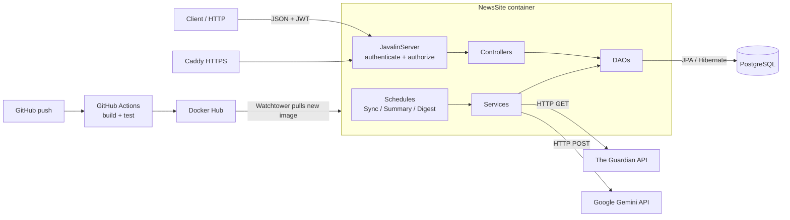
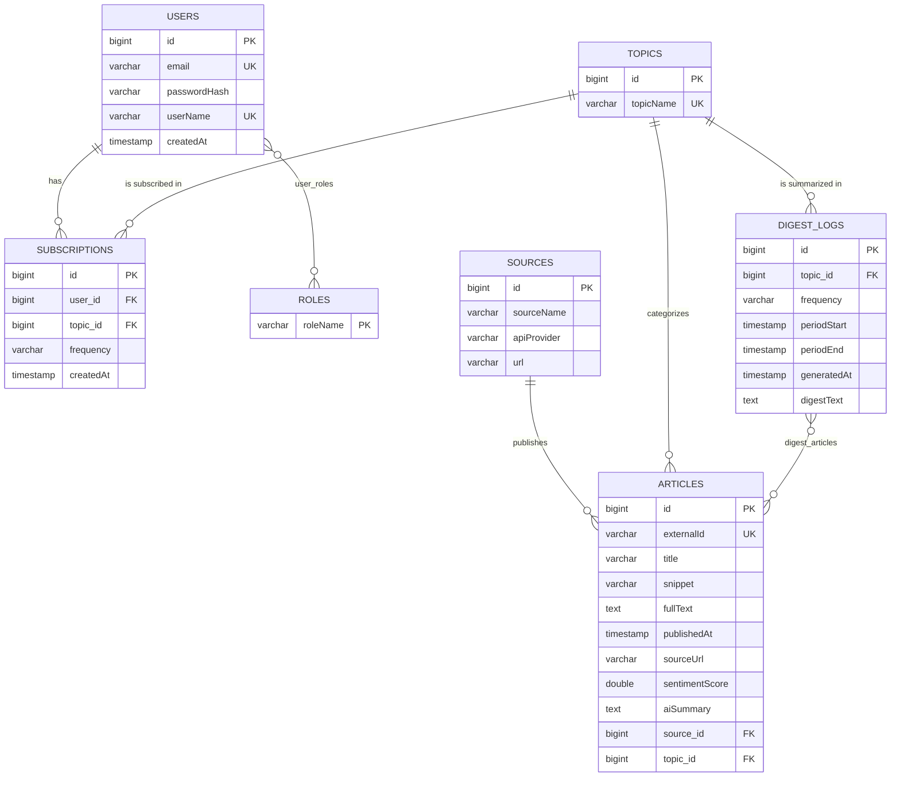

# NewsAggregator+

## Vision

NewsAggregator+ collects news articles from The Guardian, supplements them with AI summaries and sentiment scores,
and gives each user a digest of the topics they subscribe to, daily or weekly.

## Links

- Deployed application: https://news.codeshow.dk (API under `/api`, e.g. https://news.codeshow.dk/api/articles)
- Source code repository: https://github.com/BertramFM/NewsSite
- Portfolio website: https://bertramfm.github.io/hugoPortfolio/

# Architecture

## System Overview

The system is a REST API written in Java 25 with Javalin 7 and JPA/Hibernate 7 on PostgreSQL. It has two halves:

1. **REST API (request driven):** Javalin routes call controllers, controllers call DAOs, and DAOs talk to PostgreSQL through JPA.
   Controllers only work with DTOs, they never return entities directly.
2. **Background jobs (time driven):** three scheduled jobs (`ScheduledExecutorService`) keep the data up to date:
   - `SyncSchedule` (every 45 min): fetches new articles from The Guardian for 12 topics in parallel (`ExecutorService` with
     one `Callable`/`Future` per topic).
   - `ArticleSummarySentimentSchedule` (every 15 min): sends articles without a summary to Google Gemini in batches of 10 and stores
     a 2-3 sentence summary and a sentiment score between -1.0 and 1.0.
   - `DigestSchedule` (every hour): for every topic that has subscribers, creates a shared AI digest of the last completed day or week.

**Layers and packages (`app`):**

| Layer | Package | Responsibility |
|---|---|---|
| Server / routing | `app.server` | `JavalinServer` (routes, security filters, exception handlers), `AppRole` |
| Controllers | `app.controllers` | Read the request, validate input, call DAOs, return DTOs |
| Services | `app.services` | Guardian sync, AI client, digest and summary logic, schedules |
| Data access | `app.daos` | One DAO per entity (`GenericDAO<T, I>`), JPQL queries |
| Entities | `app.entities` | JPA entities and enums |
| DTOs / mappers | `app.dtos`, `app.mappers` | JSON in/out, Guardian JSON to entities |
| Config | `app.config` | `HibernateConfig` (EntityManagerFactory), `TokenSettings` |
| Errors | `app.exceptions` | `ApiException(status, message)` |

**Technologies:** Java 25, Maven, Javalin 7, JPA/Hibernate 7, PostgreSQL 16, Jackson, Lombok, JWT (TokenSecurity),
jBCrypt, Google Gemini API, The Guardian Open Platform API, JUnit 5, Testcontainers, Rest Assured, Hamcrest, Docker,
GitHub Actions, Docker Hub, Watchtower and Caddy on a DigitalOcean droplet.

## Architecture Diagram



## Key Design Decisions

- **DAO pattern with a generic interface.** `GenericDAO<T, I>` gives every entity the same CRUD methods. Each method opens its own
  `EntityManager` (try-with-resources) and rolls back on errors. Extra queries (e.g. `findForUser`) live on the concrete DAO.
- **Lazy relations + `JOIN FETCH`.** All relations are `LAZY`. Queries that need related data fetch it explicitly with
  `JOIN FETCH`, so DTOs can be built after the `EntityManager` is closed without `LazyInitializationException`.
- **Shared digests.** A digest belongs to (topic, frequency, period), not to a user. All subscribers of "technology, DAILY" read the
  same digest, so the AI is called once per topic per period instead of once per user. A user's digests are found through their
  subscriptions, and only digests generated after the user subscribed are shown.
- **One subscription per user per topic.** `subscriptions` is unique on (user, topic). This lets the API identify a subscription by
  topic name: `DELETE /api/subscriptions/technology`.
- **Authentication with JWT, passwords with bcrypt.** Login returns a signed JWT with the user's email and roles.
  Two `beforeMatched` filters run before every route: `authenticate` (valid token? otherwise 401) and `authorize` (required role?
  otherwise 403). Passwords are only stored as bcrypt hashes; hashing happens in `User.changePassword`.
- The token settings (`SECRET_KEY`, `ISSUER`, `TOKEN_EXPIRE_TIME`) are read once at startup and injected, so tests and CI
  can use their own values.
- **Roles as many-to-many.** A user can have several roles (an admin is also a USER), so each route requires exactly one role.
- **Uniform error handling.** Controllers and DAOs throw `ApiException(status, message)`. One exception handler turns it into
  `{"status": ..., "message": ...}`; anything unexpected becomes a 500 with a generic message and is logged.
- **AI behind an interface.** `AiClient` has one method, so tests use a lambda as a fake and never call Gemini.
  Article texts are sent to Gemini as data with an instruction to ignore instructions inside them. No user data is sent to Gemini.
- **Concurrency where it helps.** The Guardian sync runs one task per topic in a fixed thread pool of 3, with a timeout per topic,
  so one slow topic does not block the others.

# Data Model

## ERD



Unique constraints: `subscriptions(user_id, topic_id)`, `digest_logs(topic_id, frequency, periodStart)`,
`sources(sourceName, apiProvider)`.

## Important Entities

### User
A registered user. `email` (stored lower case) is used to log in, `userName` is unique, and only a bcrypt `passwordHash` is stored.
Has many `Subscription`s (cascade + orphan removal) and a `Set<Role>` (many-to-many through `user_roles`).

### Role
`USER` or `ADMIN`. The role name is the primary key. Every new user gets `USER`; admins are created by adding `ADMIN`.

### Subscription
A user's subscription to one `Topic` with a `Frequency` (`DAILY` or `WEEKLY`) and a `createdAt` timestamp. Unique per user and topic.

### Topic
A Guardian section such as `technology`, `science` or `world`. Articles, subscriptions and digests all point to a topic.

### Article
A news article from The Guardian. `externalId` (the Guardian id) is unique, so the same article is never stored twice.
`aiSummary` and `sentimentScore` are empty until the summary job has processed the article.

### Source
Where articles come from (name + API provider), e.g. "The Guardian" / `GUARDIAN`.

### DigestLog
A shared AI-written digest for one topic, frequency and period, with the articles it was based on (many-to-many through
`digest_articles`). Unique on topic, frequency and period start, so the job can run again without creating duplicates.

# API Documentation

Base URL: `https://news.codeshow.dk/api` (locally `http://localhost:7070/api`). All bodies are JSON.

Protected routes need the header `Authorization: Bearer <token>` from login or register.

| Method | Path | Role   | Description |
|---|---|--------|---|
| POST | `/auth/register` | anyone | Create a user, returns a token |
| POST | `/auth/login` | anyone | Log in, returns a token |
| GET | `/articles` | anyone | All articles, newest first (without full text) |
| GET | `/articles/{id}` | User   | One article with full text |
| DELETE | `/articles/{id}` | ADMIN  | Delete an article |
| POST | `/subscriptions` | USER   | Subscribe to a topic |
| GET | `/subscriptions` | USER   | My subscriptions |
| DELETE | `/subscriptions/{topicName}` | USER   | Unsubscribe from a topic |
| GET | `/digests` | USER   | Digests for my subscriptions |
| GET | `/health` | anyone | Liveness check, returns `OK` |

## Example Endpoints

### POST /api/auth/register

Request:
```json
{ "email": "anna@newssite.com", "userName": "anna", "password": "Hemmelig1!" }
```
Response `201 Created`:
```json
{ "token": "specialToken32", "email": "anna@newssite.com" }
```
Errors: `400` weak password (at least 8 characters, one digit and one special character), `409` email or user name already in use.

### POST /api/auth/login

Request:
```json
{ "email": "anna@newssite.com", "password": "Hemmelig1!" }
```
Response `200 OK`:
```json
{ "token": "specialToken32", "email": "anna@newssite.com" }
```
Errors: `401` with the same message for unknown email and wrong password.

### GET /api/articles

Response `200 OK`:
```json
[
  {
    "id": 42,
    "externalId": "technology/2026/oct/29/new-chip-announced",
    "title": "New chip announced",
    "snippet": "A new chip was announced...",
    "publishedAt": "2026-10-29T12:00:00",
    "sourceUrl": "https://www.theguardian.com/technology/...",
    "sourceName": "The Guardian",
    "topicName": "technology",
    "sentimentScore": 0.4,
    "aiSummary": "A company announced a new chip..."
  }
]
```

### GET /api/articles/{id}

Same fields as above plus `fullText`. Errors: `400` if the id is not a number, `404` if the article does not exist.

### DELETE /api/articles/{id} (ADMIN)

Response `200 OK`:
```json
{ "message": "Article deleted", "id": 42 }
```
Errors: `401` without token, `403` if the user is not ADMIN, `404` unknown id.

### POST /api/subscriptions (USER)

Request:
```json
{ "topicName": "technology", "frequency": "DAILY" }
```
Response `201 Created`:
```json
{ "id": 7, "topicName": "technology", "frequency": "DAILY", "createdAt": "2026-10-30T02:15:00" }
```
Errors: `400` unknown frequency, `404` unknown topic, `409` already subscribed to the topic.

### GET /api/subscriptions (USER)

Response `200 OK`: a list of subscriptions in the same format, sorted by topic name.

### DELETE /api/subscriptions/{topicName} (USER)

Response `200 OK`:
```json
{ "message": "Subscription deleted", "topicName": "technology" }
```
Errors: `404` if the user does not subscribe to the topic (also when another user does).

### GET /api/digests (USER)

Response `200 OK`:
```json
[
  {
    "id": 3,
    "topicName": "technology",
    "frequency": "DAILY",
    "periodStart": "2026-10-29T00:00:00",
    "periodEnd": "2026-10-30T00:00:00",
    "generatedAt": "2026-10-30T01:05:00",
    "digestText": "- A new chip was announced...\n- ..."
  }
]
```

# User Stories

1. As a visitor, I want to browse the latest news articles with a short AI summary and a sentiment score, so I can quickly see what
   is happening and the tone of the news.
2. As a visitor, I want to open one article and read the full text.
3. As a visitor, I want to create an account and log in, so I can get personal content.
4. As a user, I want to subscribe to a topic daily or weekly, so I get news about what interests me.
5. As a user, I want to see and remove my subscriptions.
6. As a user, I want to read AI-written digests for the topics I subscribe to, so I do not have to read every article.
7. As an admin, I want to delete articles, so I can remove unwanted content.
8. As the system, I want to fetch new articles regularly without storing duplicates, so the data stays fresh.
